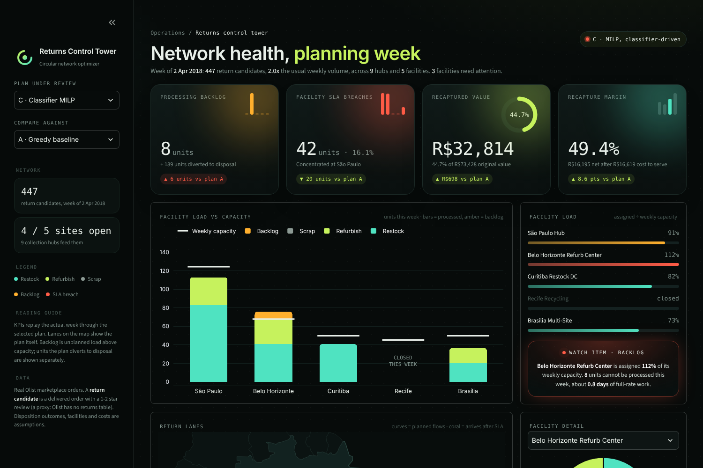
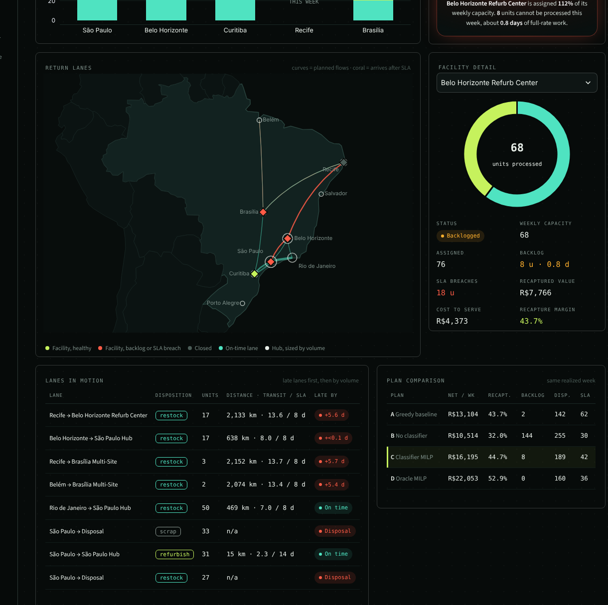
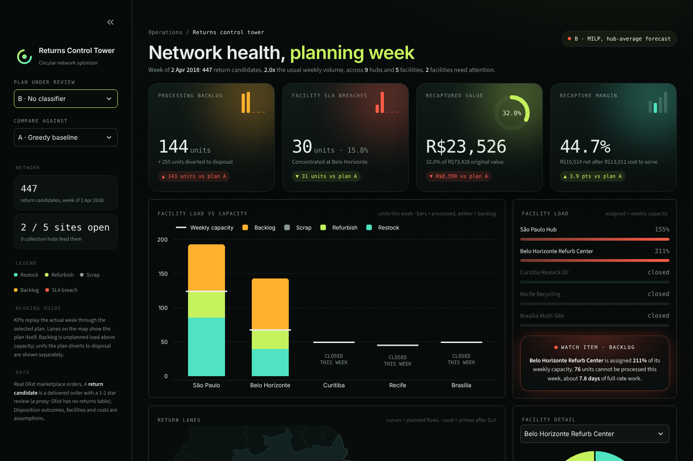

# ♻️ Reverse Logistics Circular Economy Network Optimizer


---

# 📖 Project Overview

Most supply chain projects look at the forward flow: getting products to customers. This one looks at the way back. When a marketplace takes returns, every parcel has to go somewhere (restock, refurbish or scrap), and each choice trades off shipping cost, processing capacity, delivery deadlines, recovered value and emissions.

This project builds the full decision loop for that problem and a Returns Control Tower dashboard on top of it:

1. **Predict** which delivered orders will come back, before they do.
2. **Optimize** where the returns should be routed and which facilities should be open.
3. **Evaluate** each plan against the week that actually happened, not only against the forecast it was built on.
4. **Monitor** processing backlogs, facility SLA breaches and recaptured value margins in a custom dashboard.

This project includes:

- 📦 95,160 real Olist orders turned into an order-level table with real prices, weights, locations and delivery timelines
- 🤖 A calibrated ensemble that predicts return candidates, tested strictly out-of-time
- 🧮 A Mixed-Integer Linear Program (MILP) that routes returns and decides which sites open or close
- 🚚 Freight cost and transit time **calibrated on real Olist shipments**, not invented
- 🔁 A realized-week evaluator, plus a **32-week rolling backtest**
- 🛰 A live Streamlit Returns Control Tower (Dashboard) with a Brazil lane map, facility drill-down and plan comparison
- ✅ 23 tests, including MILP cases solved by hand

---

## ⚠️ What is real, what is a proxy, what is assumed

Olist has **no returns table**, so this project is explicit about what each number rests on.

| Layer | Status | Detail |
|-------|--------|--------|
| Orders, prices, freight, product weight and size, seller and customer locations, delivery timestamps, review scores | **Real** | Straight from the Olist data |
| Freight cost per parcel and transit days per leg | **Calibrated** | Median regression on real shipments (see below) |
| "Return candidate" | **Proxy** | A delivered order whose review score is 1 or 2 stars. This is an upper-bound stand-in for a return, not an observed return |
| Disposition (restock, refurbish or scrap) | **Assumed** | A documented mix by product group, in `rl_network/config.py`. No public dataset records this |
| Facilities, capacities, processing and fixed costs, SLAs | **Assumed** | Hypothetical sites in real Brazilian cities |

---

## 📸 Dashboard Preview

### 🟢 Returns Control Tower (classifier-driven plan)



### 🗺 Lane map, facility detail and plan comparison



### ⚠️ The same week planned without the classifier

The hub-average forecast saw about 244 returns, closed three of five sites, and then 447 arrived. The dashboard shows two sites at 155% and 211% of capacity.



---

## 📂 Dataset

| Feature | Details |
|---------|---------|
| Source | [Brazilian E-Commerce Public Dataset by Olist](https://www.kaggle.com/datasets/olistbr/brazilian-ecommerce) (Kaggle, CC BY-NC-SA 4.0) |
| Raw orders | 99,441 orders from 2016 to 2018 |
| Analysis table | 95,160 delivered, reviewed, geolocated orders |
| Return-candidate rate | 12.8% overall (1 or 2 star reviews) |
| Network | 9 regional collection hubs built from real customer states, and 5 hypothetical processing facilities |
| Planning weeks | 32 weeks from 8 Jan to 27 Aug 2018, each with at least 1,000 deliveries |
| Unit | One returned **order** (a parcel) |

The raw CSV files are **not stored in this repository** (size and licence). Download them from Kaggle and place them in `data/olist/` (see "How to Use").

### What the real data revealed

- **Delivery delay is the dominant signal.** 54% of late deliveries get a 1 or 2 star review, against 9% of on-time ones.
- **Real disruption weeks exist.** In the week of 2 April 2018, 22% of deliveries were late and return candidates reached **447, about twice the usual level** (226 per week over the previous 13 weeks). That week is the featured planning week: the peak-return week in the evaluation window, chosen by rule and not by hand.
- **Customer history is useless here.** Only about 3% of Olist customers order twice, so customer-level return history was not used.
- **Regions differ.** Return-candidate rates range from about 11% in São Paulo to about 18% in Rio de Janeiro.

---

## 🛠 Techniques Used

| Technique | Purpose |
|-----------|---------|
| Median (quantile) regression | Calibrates freight cost and transit time on real shipments, robust to long right tails |
| MILP with PuLP (CBC or HiGHS) | Routing flows, binary facility open/close decisions, capacity and minimum-utilization constraints |
| Soft SLA penalty and 5% capacity buffer | Late deliveries cost money, and forecast error does not instantly create backlog |
| Soft-voting ensemble | Random forest, gradient boosting and logistic regression combined |
| Time-ordered isotonic calibration | Probabilities become expected volumes, so they must be reliable. Calibration data is always newer than training data |
| Out-of-time evaluation | Labels count as known only once the review has been answered, so there is no look-ahead |
| Strong baselines | Global rate, hub rate, and a late-delivery × hub rule, to show what machine learning adds |
| Realized-week replay | Plans are scored on the actual week, with capacity rescaling and overflow counted |
| Rolling backtest | 32 weeks, retrained every 4 weeks, to avoid judging the method on one lucky week |
| Marginal abatement curve | Sweeping a carbon shadow price shows what lower emissions would cost |
| Streamlit and Plotly | Custom dark UI with injected CSS, SVG gauges and an offline Brazil map |
| pytest | MILP checked against hand-solved instances, plus label, split and invariant tests |

---

## 🚚 Calibration on Real Shipments

Fitted on 10,000 delivered orders available before the planning week:

- **Freight per parcel** = R$12.35 + R$0.0032 per km + R$0.0022 per kg·km. Mean absolute error R$6.25, against R$8.77 for a flat median.
- **Transit days** = 1.24 + 0.268 × √km. Mean absolute error 3.9 days, against 4.8 days for a flat median.

The reverse leg is assumed to cost the same as the outbound leg, because Olist has no reverse-freight data.

---

## 🧮 How the Optimizer Works

For every hub *h*, facility *f* and disposition *d*:

- `x[h,f,d]` units routed, `u[h,d]` units sent to disposal, `y[f]` facility open (binary)

**Minimize** shipping + processing + SLA lateness penalty + carbon cost + fixed site cost + disposal fees − recovered value

**Subject to**

1. Flow conservation: everything arriving at a hub is routed or disposed of
2. Per-disposition capacity at each facility, with a 5% planning buffer
3. Total throughput capacity at each facility
4. Minimum utilization for any open facility

Recovered value uses each facility's yield, so `1 − yield` is its scrap rate. Disposal is always available, so the model is always feasible. Facility capacities are **fixed** from the median weekly volume of the previous 13 weeks, so a surge week genuinely stresses the network.

---

## 🧪 Four Plans, One Realized Week

Every plan is evaluated on the same real returns.

| Plan | Built from | Purpose |
|------|------------|---------|
| **A** Greedy baseline | Classifier forecast, nearest facility first, all sites open | The simple policy to beat |
| **B** No classifier | This week's deliveries × each hub's historical return rate, MILP | Measures the value of the classifier |
| **C** Classifier MILP | Classifier forecast, MILP | **The proposed system** |
| **D** Oracle MILP | True volumes, no buffer | Perfect-information lower bound on cost |

---

## 📌 Key Findings

### The classifier (featured week, trained only on data known before it)

| | Classifier | Late × hub rule | Hub rate | Global rate |
|---|---|---|---|---|
| ROC-AUC | **0.860** | 0.808 | 0.609 | 0.500 |
| Brier score (lower is better) | **0.104** | 0.124 | 0.184 | 0.186 |
| Forecast of total returns (actual 447) | **452 (+1%)** | 375 (−16%) | 244 (−45%) | 249 (−44%) |

- Calibration error is 0.011 after calibration, against 0.041 before. The top decile of orders returns 3.7 times the average rate.
- The strongest features are delivery delay, number of items in the order and delivery time.
- Forecast error per hub and disposition is **14.9%** with the classifier against **46.0%** from the historical hub average.

### The plans (featured week, 2 April 2018, 447 return candidates)

| | A Greedy | B No classifier | C Classifier MILP | D Oracle |
|---|---|---|---|---|
| Net contribution / week | R$13,104 | R$10,514 | **R$16,195** | R$22,053 |
| Value recapture rate | 43.7% | 32.0% | 44.7% | 52.9% |
| Cost to serve | R$19,012 | R$13,012 | R$16,619 | R$16,762 |
| Units diverted to disposal | 142 | 255 | 189 | 160 |
| Backlog (units) | 2 | 144 | 8 | 0 |
| SLA-breach units | 62 | 30 | 42 | 36 |
| Sites open | 5 | 2 | 4 | 4 |
| CO₂ (kg) | 576 | 776 | 644 | 580 |

- **Ignoring the surge is costly.** Plan B expected about 244 returns, closed three of five sites, and then faced 447. Two sites ran at 155% and 211% of capacity, 144 units backed up and 255 went to disposal. Plan C earns about **R$5.7K more per week** than B.
- **The network is overloaded in any plan.** Capacity was sized for about 226 returns a week, and 447 arrived, so even the oracle diverts 160 units. The classifier's value is in handling that overload sensibly.

### The 32-week backtest (retrained every 4 weeks)

| | Result |
|---|---|
| Mean net contribution per week | A R$5,467 · B R$7,803 · **C R$10,038** · D R$10,980 |
| C against B | **+R$2,235 per week on average** (median +R$1,588), better in **29 of 32 weeks** |
| C against A | +R$4,571 per week, better in 32 of 32 weeks |
| C against the oracle | trails by R$942 per week |
| Surge weeks (11 weeks, at least 1.3× normal volume) | C beats B by R$4,316 per week |
| Normal weeks (21 weeks) | C beats B by R$1,146 per week |
| Weeks where C lost to B | 3, by at most R$467 |
| Classifier AUC | mean 0.757, from 0.625 to 0.861 (0.81 in surge weeks, 0.73 in normal weeks) |
| Forecast error on weekly total returns | 5.4% with the classifier against 28.6% with the hub average |

- **The featured week is a stress test, not a typical week.** Typical gains are smaller (about R$2.2K per week, not R$5.7K).
- **About half of the MILP's edge over greedy comes from closing one site.** In the featured week, C earns R$3,091 more than A, of which R$1,600 is the fixed cost of the closed Recife site. The rest is mainly cheaper shipping.
- **Scrap rarely justifies a shipment.** At the calibrated freight rates, shipping a low-value item to a recycling site costs more than the assumed R$8 disposal fee. Plan C processes no scrap and the oracle only 5 units, while the greedy baseline ships 63 scrap units and pays for it. This result depends on the assumed disposal fee.
- **Emissions barely move routing at realistic prices.** Freight is a small share of cost. At a shadow price of R$50 per kg, the optimizer reopens a fifth site and CO₂ falls about 17% (644 to 537 kg), at a cost of roughly R$2,000 per week, about 12% of net contribution.

---

## 🛰 Returns Control Tower (Streamlit)

Focused entirely on three things for the selected plan: processing backlog, facility SLA breaches and recaptured value margins.

| Panel | What it shows |
|-------|---------------|
| KPI cards | Backlog (with units diverted to disposal), SLA breaches, recaptured value (with ring gauge), recapture margin, each with a delta against a comparison plan you choose |
| Facility load vs capacity | Processed units by disposition, backlog in amber, capacity marker per site |
| Facility load and watch item | Load per site, plus an auto-generated note naming the worst backlog or SLA lane, or an all-clear |
| Return lanes map | Planned flows across Brazil as arcs, coral when a lane arrives after its SLA |
| Facility detail | Disposition mix, status, backlog, SLA breaches, recaptured value, cost to serve, recapture margin |
| Lanes and plan tables | Late lanes first, plus a side-by-side comparison of all four plans |

**Recapture margin** = (recovered value − cost to serve) ÷ recovered value, using the same definition per facility and overall. The sidebar and footer state the data caveats on every view.

---

## 💡 Design Decisions

- **Time-aware everywhere.** A label counts as known only after the customer answered the review. Models, hub rates, calibration and the capacity reference use only data available before the planning week.
- **Plans are judged on reality, not on their own forecast.** The evaluator replays actual volumes through each plan's routing shares. If a facility is overloaded, the overflow is its backlog.
- **The proxy is stated, not hidden.** The README, the dashboard sidebar and the dashboard footer all say that a return candidate is a 1 or 2 star review.
- **Assumptions stay assumptions.** Dispositions are not "predicted" by a model trained on rules I wrote. They are an explicit table, and the real learning target is whether an order comes back.
- **Strong baselines.** The classifier is compared with a late-delivery × hub rule, not only with a flat average.
- **The oracle has no buffer.** It faces the same constraints as the realized world, so it is a true lower bound.
- **Every assumption lives in one file.** `rl_network/config.py` holds the hubs, facilities, costs, SLAs and disposition mix.
- **The map works offline.** Country outlines are bundled (Natural Earth, public domain).

---

## ⚠️ Limitations

- **Returns are a proxy.** A 1 or 2 star review often reflects service problems, not a physical return, so volumes are an upper bound. Treat the results as a method demonstration on real logistics data, not as measured return savings.
- **Dispositions, facilities, capacities and costs are assumed.** The headline money figures depend on them.
- **Olist is outbound data.** The reverse leg is assumed to cost the same as the outbound leg.
- **Classifier accuracy varies by week.** AUC is 0.81 in surge weeks and 0.73 in normal weeks. Its signal is mostly delivery delay.
- **Overflow is costed as disposal.** Units beyond capacity are treated as diverted that week, not queued for the next.
- **Single-week planning.** There is no multi-period inventory or queue model.
- **Small weekly volumes.** Roughly 130 to 450 return candidates a week, so absolute money figures are small. Relative comparisons between plans matter more.
- **Data period is 2017 to 2018.** Unusually thin weeks (fewer than 1,000 deliveries) are excluded from the backtest.

---

## 📂 Repository Structure

```text
reverse-logistics-optimizer/
├── app.py                          # Streamlit Returns Control Tower
├── run_pipeline.py                 # Olist -> model -> MILP -> evaluation -> outputs/
├── rl_network/
│   ├── config.py                   # hubs, facilities, costs, SLAs, disposition mix (REAL / PROXY / ASSUMED legend)
│   ├── olist_data.py               # raw CSVs -> order table, return-candidate label, dispositions
│   ├── calibration.py              # freight and transit calibration on real shipments
│   ├── classifier.py               # return-propensity ensemble, calibration, baselines
│   ├── demand.py                   # expected, realized and no-classifier demand
│   ├── network.py                  # hubs, facilities, distances, transit times
│   ├── optimizer.py                # MILP formulation and greedy baseline
│   ├── evaluation.py               # realized-week replay and KPIs
│   └── planning.py                 # one planning week end to end, no-look-ahead splits
├── tests/test_project.py           # 23 tests
├── data/
│   ├── olist/                      # put the Olist CSV files here (not committed)
│   └── brazil_outline.json         # offline map geometry
├── outputs/                        # results read by the dashboard
├── images/                         # screenshots used in this README
├── .streamlit/config.toml          # dashboard theme
├── requirements.txt                # dashboard only (Streamlit Cloud installs this)
├── requirements-full.txt           # everything: pipeline, solver, tests, dashboard
└── README.md
```

### Output files

| File | Contents |
|------|----------|
| `scenario_summary.csv` | Headline KPIs for each plan |
| `facility_kpis.csv` | Per facility: load, backlog, backlog days, SLA breaches, recovered value, cost to serve, margin |
| `routing_plan.csv`, `realized_routing.csv` | Planned flows, and realized lane flows with SLA breaches and value |
| `returns_scored.csv` | Per-order return probability, assumed disposition mix and the actual outcome |
| `classifier_metrics.json`, `calibration_table.csv`, `feature_importance.csv` | Model quality, calibration and drivers |
| `volume_forecast_vs_actual.csv` | Hub by disposition forecast against actual |
| `backtest_weekly.csv`, `backtest_gain_by_week.csv`, `backtest_summary.json` | The 32-week backtest |
| `carbon_sensitivity.csv` | Cost against emissions across carbon shadow prices |
| `weekly_series.csv` | Weekly deliveries, return candidates and late rate for context |
| `network_facilities.csv`, `network_distance_km.csv`, `dim_scenario.csv`, `run_config.json` | Network description, run settings and calibration |

---

# 🚀 How to Use the Project

1. Clone the repository.

```bash
git clone https://github.com/kazimalizaidi/reverse-logistics-optimizer.git
cd reverse-logistics-optimizer
```

2. Install everything (Python 3.11 or newer recommended).

```bash
pip install -r requirements-full.txt
```

3. Download the Olist dataset from [Kaggle](https://www.kaggle.com/datasets/olistbr/brazilian-ecommerce) and put these files in `data/olist/`: `olist_orders_dataset.csv`, `olist_order_items_dataset.csv`, `olist_order_reviews_dataset.csv`, `olist_customers_dataset.csv`, `olist_products_dataset.csv`, `olist_sellers_dataset.csv`, `olist_geolocation_dataset.csv` and `product_category_name_translation.csv`.

4. Run the pipeline. On a single core, the featured week takes about 2 minutes and the backtest about 2 more.

```bash
python run_pipeline.py                    # featured week (peak returns) + backtest
python run_pipeline.py --no-backtest      # featured week only
python run_pipeline.py --backtest-only    # backtest only
python run_pipeline.py --week 2018-03-19  # any Monday present in the data
```

5. Launch the dashboard from the project root.

```bash
streamlit run app.py
```

6. Run the tests. The real-data check runs only if the Olist files are present.

```bash
pytest -q
```

7. Use the sidebar to pick a plan and a comparison plan. If the sidebar is collapsed, click the small arrow at the top left.

**Hosting:** the dashboard only needs `requirements.txt` and the committed `outputs/` folder, so it deploys directly to Streamlit Community Cloud with `app.py` as the main file. The raw Olist data is not needed there.

---

# 📌 Future Improvements

- Replace the review proxy with a genuine returns signal if a marketplace dataset with refunds becomes available
- Multi-period planning with queues, so backlog carries into the next week
- Robust or stochastic optimization that plans against forecast uncertainty directly
- A learned disposition model once real inspection outcomes exist
- Seller-level quality features (with careful time-aware encoding)
- Scheduled pipeline runs and an API for scoring new orders

---

# 📚 References & Data Sources

- **Data:** Olist, *Brazilian E-Commerce Public Dataset by Olist* (Kaggle, CC BY-NC-SA 4.0). Please credit Olist if you reuse it.
- **Map geometry:** Natural Earth 1:110m country boundaries (public domain).
- **Optimization:** PuLP with the CBC or HiGHS solver.

---

# 🎧 Project Soundtrack

*This track was on loop while working on this project*

[Next to You - Alicks](https://open.spotify.com/track/36MF5O3oyr7RppWoG69jca?si=d62468106cea46e8)

**Star this repository if you found it interesting!** ⭐

made with ❤️ by **kazim**
