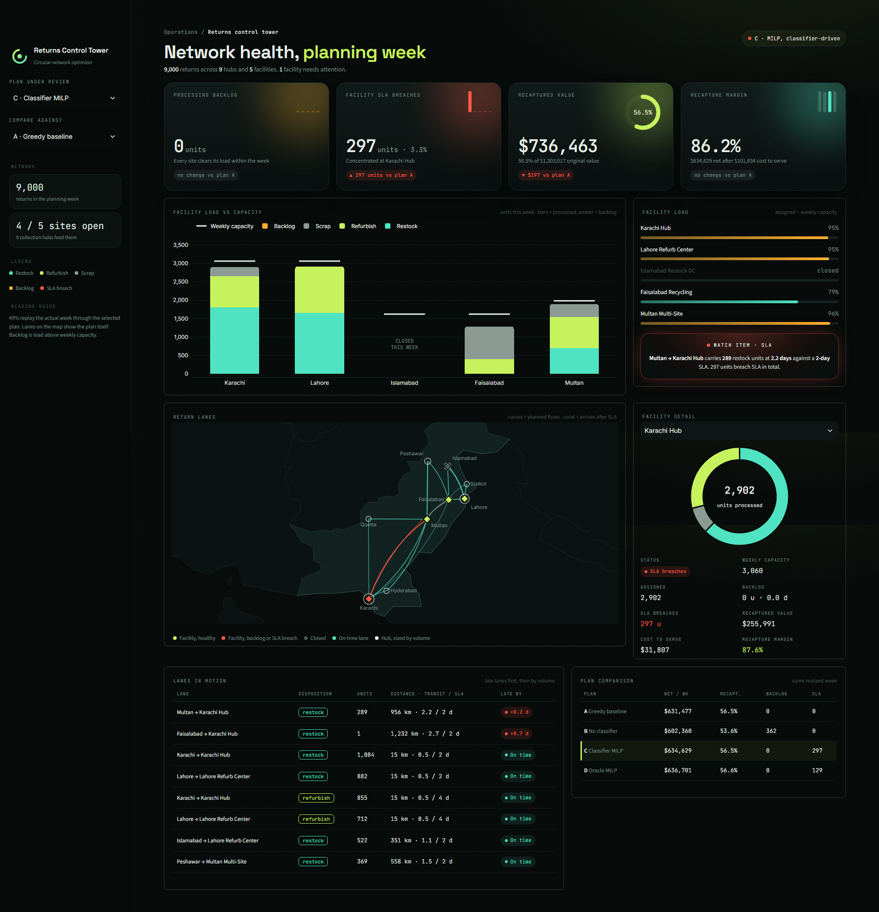

# ♻️ Reverse Logistics Circular Economy Network Optimizer


---

# 📖 Project Overview

Most supply chain frameworks look at the forward flow: getting products to customers. This one looks at the way back. When an e-commerce or manufacturing brand takes returns, every item has to be sent somewhere (restock, refurbish or scrap), and each choice trades off shipping cost, processing capacity, delivery deadlines, recovered value and emissions, so what my framework actually does is

1. **Predict** what each return will become *before* it reaches a warehouse.
2. **Optimize** where every return should be routed, and which facilities should be open.
3. **Evaluate** each plan against the week that actually happens, not just the forecast it was built on.
4. **Monitor** processing backlogs, facility SLA breaches and recaptured value margins in a custom dashboard.

This project includes:

- 🤖 A calibrated ensemble classifier that predicts restock, refurbish or scrap at pickup time
- 🧮 A Mixed-Integer Linear Program (MILP) that routes returns and decides which sites open or close
- 🔁 A realized-week evaluator that replays actual volumes through each plan to expose backlog and SLA breaches
- 🌍 A carbon shadow-price sweep that shows what lower emissions would cost
- 🛰 A Streamlit Returns Control Tower with a lane map, facility drill-down and plan comparison
- ✅ 11 tests, including MILP cases solved by hand

---

## 📸 Dashboard Preview




---

## 📂 Dataset

| Feature | Details |
|---------|---------|
| Type | Synthetic returns data generated for this project (not real company data) |
| Records | 30,000 returns: 21,000 history for training and a 9,000-return planning week |
| Network | 9 collection hubs and 5 processing facilities across Pakistani cities (real coordinates, invented capacities and costs) |
| Outcomes | Restock, refurbish, scrap |
| Categories | Electronics, appliances, home, apparel, beauty, toys |
| Features | Price, weight, category, return reason, reported condition, customer return rate, order count, tenure, days since purchase, transit days, origin hub |

Two design choices keep the data honest:

- **Labels are sampled, not rule-assigned.** Outcomes are drawn from latent probabilities, so two identical returns can end differently and no model can reach 100%. The generator keeps the true probabilities, which gives a Bayes-optimal accuracy ceiling to measure the classifier against.
- **The planning week is deliberately different from history.** It has a promo-driven electronics and appliance peak. A forecast built only from the historical class mix is therefore biased, which is what makes the classifier worth having.

---

## 🛠 Techniques Used

| Technique | Purpose |
|-----------|---------|
| MILP with PuLP (CBC or HiGHS) | Routing flows, binary facility open/close decisions, capacity and minimum-utilization constraints |
| Soft SLA penalty | Late deliveries cost money instead of making the model infeasible |
| Planning capacity buffer (5%) | Headroom so forecast error does not immediately create backlog |
| Soft-voting ensemble | Random forest, gradient boosting and logistic regression combined |
| Isotonic calibration | Probabilities are used as expected volumes, so they must be reliable, not just the top label |
| Bayes-oracle benchmark | The generator's true probabilities give an upper bound for accuracy and log-loss |
| Permutation importance | Which features drive predictions |
| Realized-week replay | Plans are scored on the actual week, with capacity rescaling and overflow counted as backlog |
| Marginal abatement curve | Sweeping the carbon shadow price from $0 to $100/kg shows the cost of cutting emissions |
| Streamlit and Plotly | Custom dark UI built with injected CSS, SVG gauges and offline map geometry |
| pytest | MILP checked against instances solved by hand, plus constraint and cost-identity invariants |

---

## 🧮 How the Optimizer Works

For every hub *h*, facility *f* and disposition *d*:

- `x[h,f,d]` units routed, `u[h,d]` units sent to disposal, `y[f]` facility open (binary)

**Minimize** shipping + processing + SLA lateness penalty + carbon cost + fixed site cost + disposal fees − recovered value

**Subject to**

1. Flow conservation: everything arriving at a hub is routed or disposed of
2. Per-disposition capacity at each facility, with a 5% planning buffer
3. Total throughput capacity at each facility
4. Minimum utilization for any open facility

Recovered value uses each facility's yield, so `1 − yield` is its scrap rate: units that fail processing earn only salvage value. Disposal is always available, so the model is always feasible.

---

## 🧪 Four Plans, One Realized Week

Every plan is evaluated on the same 9,000 actual returns.

| Plan | Built from | Purpose |
|------|------------|---------|
| **A** Greedy baseline | Classifier forecast, nearest facility first, all sites open | The simple policy to beat |
| **B** No classifier | Historical class mix only, MILP | Measures the value of the classifier |
| **C** Classifier MILP | Classifier forecast, MILP | **The proposed system** |
| **D** Oracle MILP | True volumes, no buffer | Perfect-information lower bound on cost |

---

## 📌 Key Findings (seed 42, planning week of 9,000 returns)

| | A Greedy | B No classifier | C Classifier MILP | D Oracle |
|---|---|---|---|---|
| Net contribution / week | $631,471 | $602,360 | **$634,616** | $636,701 |
| Cost to serve | $105,184 | $96,141 | $101,833 | $100,168 |
| Value recapture rate | 56.5% | 53.6% | 56.5% | 56.6% |
| Units sent to disposal | 0 | 669 | 0 | 0 |
| Backlog (units) | 0 | 362 | 0 | 0 |
| SLA-breach units | 0 | 0 | 297 | 129 |
| Sites open | 5 | 4 | 4 | 4 |
| CO₂ (kg) | 6,753 | 7,689 | 6,885 | 6,812 |

- **The classifier is close to the ceiling.** Accuracy is **81.7%** against a ceiling of **81.9%** set by the data generator, and 46.2% for always guessing the majority class. Log-loss is 0.468 against 0.461 for the oracle and 1.042 with no model.
- **It fixes the demand forecast.** Error in expected volume per hub and disposition (WAPE) is **2.8%** with the classifier against **18.2%** from the historical mix.
- **Ignoring the promo shift is expensive.** Plan B closes a different site (Faisalabad, where plan C closes Islamabad), fills Lahore's refurbish line, backlogs 362 units and sends 669 to disposal. Plan C earns about **$32K more per week** than B.
- **MILP beats greedy, modestly.** C earns about **$3.1K more per week** than A, roughly 3% lower cost to serve, mostly from closing one site. C finishes within about **$2.1K per week** of perfect information.
- **Results are stable.** Across seeds 1 to 3, C beats B by $30K to $63K per week, beats A by $2.0K to $3.2K, and trails the oracle by $2.1K to $2.7K.
- **Lower cost to serve is not always better.** B has a lower cost to serve than A and C, but part of that is simply because it processes fewer units (669 go to disposal). Net contribution is the fair comparison.
- **Emissions barely move routing at realistic prices.** At about $0.10/kg, freight is too small a share of cost to change the plan. At a $25/kg shadow price the optimizer reopens a fifth site and cuts CO₂ by about 2.2%.

---

## 🛰 Returns Control Tower (Streamlit)

Focused entirely on three things for the selected plan: processing backlog, facility SLA breaches and recaptured value margins.

| Panel | What it shows |
|-------|---------------|
| KPI cards | Backlog, SLA breaches, recaptured value (with ring gauge), recapture margin, each with a delta against a comparison plan you choose |
| Facility load vs capacity | Processed units by disposition, backlog in amber, capacity marker per site |
| Facility load and watch item | Load per site, plus an auto-generated note naming the worst backlog or SLA lane, or an all-clear |
| Return lanes map | Planned flows as arcs, coral when a lane arrives after its SLA |
| Facility detail | Disposition mix, status, backlog, SLA breaches, recaptured value, cost to serve, recapture margin |
| Lanes and plan tables | Late lanes first, plus a side-by-side comparison of all four plans |

**Recapture margin** = (recovered value − cost to serve) ÷ recovered value, using the same definition per facility and overall.

---

## 💡 Design Decisions

- **Plans are judged on reality, not on their own forecast.** The evaluator replays actual volumes through each plan's routing shares. If a facility is overloaded, the overflow is its backlog.
- **Backlog can come from one full line.** A site can be at 86% of total capacity while its refurbish line is full. The dashboard names the full line instead of quoting a misleading percentage.
- **Probabilities, not labels, drive the optimizer.** Expected volumes are summed from calibrated probabilities, so uncertainty is carried into the plan.
- **The oracle has no buffer.** It faces the same constraints as the realized world, so it is a true lower bound.
- **Every assumption lives in one file.** `rl_network/config.py` holds all costs, capacities, SLAs and emission factors.
- **The map works offline.** Country outlines are bundled (Natural Earth, public domain) so the map does not depend on a tile server.

---

## ⚠️ Limitations

- **All data is synthetic.** The results show that the method works, not what a real network would save. Classifier accuracy is meaningful only relative to the generator's known ceiling.
- **Capacities and costs are invented.** Replace `rl_network/config.py` with real figures to use this for a real network.
- **The MILP gain over greedy is modest** and comes mostly from closing one site. It would grow with tighter capacity or more varied costs.
- **Calibration helped log-loss slightly** (0.470 to 0.468), but top-label calibration error rose slightly (0.0045 to 0.0098). Both are reported in `classifier_metrics.json`.
- **The cost-optimal plan accepts some lateness** (3.3% of units breach SLA in plan C) because the penalty is a soft $0.75 per unit-day. Raise `Econ.late_penalty` to trade cost for service.
- **Backlogged units are costed as disposed that week.** They are not carried into the next week.
- **Single-week planning.** There is no multi-period inventory or queue model.

---

## 📂 Repository Structure

```text
reverse-logistics-network-optimizer/
├── app.py                      # Streamlit Returns Control Tower
├── run_pipeline.py             # data -> classifier -> MILP -> evaluation -> outputs/
├── rl_network/
│   ├── config.py               # every assumption: network, costs, SLAs, emissions
│   ├── network.py              # hubs, facilities, distances, transit times
│   ├── data_generation.py      # synthetic returns with sampled labels
│   ├── classifier.py           # calibrated ensemble and metrics vs references
│   ├── demand.py               # demand from probabilities, labels or prior
│   ├── optimizer.py            # MILP formulation and greedy baseline
│   └── evaluation.py           # realized-week replay and KPIs
├── tests/test_project.py       # 11 tests
├── outputs/                    # CSV and JSON results read by the dashboard
├── data/south_asia_outline.json  # offline map geometry
├── images/                     # screenshots used in this README
├── .streamlit/config.toml      # dashboard theme
├── requirements.txt            # dashboard only (Streamlit Cloud installs this)
├── requirements-full.txt       # everything: pipeline, solver, tests, dashboard
└── README.md
```

### Output files

| File | Contents |
|------|----------|
| `scenario_summary.csv` | Headline KPIs for each plan |
| `facility_kpis.csv` | Per facility: load, backlog, backlog days, SLA breaches, recovered value, cost to serve, margin |
| `routing_plan.csv` | Planned hub, facility and disposition flows |
| `realized_routing.csv` | Realized lane flows with SLA breaches and value recovered |
| `returns_scored.csv` | Per-return predictions and confidence |
| `volume_forecast_vs_actual.csv` | Hub by disposition forecast against actual |
| `carbon_sensitivity.csv` | Cost against emissions across carbon shadow prices |
| `classifier_metrics.json`, `feature_importance.csv` | Model quality and drivers |
| `network_facilities.csv`, `network_distance_km.csv`, `dim_scenario.csv`, `run_config.json` | Network description and run settings |

---

# 🚀 How to Use the Project

1. Clone the repository.

```bash
git clone https://github.com/kazimalizaidi/reverse-logistics-network-optimizer.git
cd reverse-logistics-network-optimizer
```

2. Install everything (Python 3.11 or newer recommended).

```bash
pip install -r requirements-full.txt
```

3. Run the pipeline. It takes about a minute and writes `outputs/`.

```bash
python run_pipeline.py
```

4. Launch the dashboard from the project root.

```bash
streamlit run app.py
```

5. Run the tests.

```bash
pytest -q
```

6. Use the sidebar to pick a plan and a comparison plan. If the sidebar is collapsed, click the small arrow at the top left.

**Using your own data:** provide a table with the columns listed in `classifier.FEATURES` plus `price`, `weight_kg`, `hub_idx` and `disposition_idx` (0 restock, 1 refurbish, 2 scrap), then replace the two `generate_returns` calls in `run_pipeline.py`. Update `rl_network/config.py` with your own network.

**Hosting:** the dashboard only needs `requirements.txt`, so it deploys directly to Streamlit Community Cloud with `app.py` as the main file. Commit `outputs/` so the app has data to read.

---

# 📌 Future Improvements

- Real returns data as the base, for example an e-commerce orders dataset with a modeled returns layer
- Multi-period planning with queues, so backlog carries into the next week
- Robust or stochastic optimization that plans against forecast uncertainty directly
- Per-line capacity shown explicitly in the facility drill-down
- Cost-to-serve breakdown (shipping, processing, fixed) as a waterfall
- Scheduled pipeline runs with an API for scoring new returns

---

# 📚 References & Data Sources

- **Data:** synthetic returns generated for this project. City coordinates are real, while capacities, costs and returns are invented.
- **Map geometry:** Natural Earth 1:110m country boundaries (public domain).
- **Optimization:** PuLP with the CBC or HiGHS solver.

---

# 🎧 Project Soundtrack

*This track was on loop while working on this project*

[Next to You - Alicks](https://open.spotify.com/track/36MF5O3oyr7RppWoG69jca?si=d62468106cea46e8)

**Star this repository if you found it interesting!** ⭐

made with ❤️ by **kazim**
